# AP2 · 三维层级场景：太阳系

> 课程：计算机图形学应用实践
> 教材：Angel & Shreiner, *Interactive Computer Graphics*, 8th ed.（Ch4–Ch5）
> 技术栈：**原生 WebGL 2.0 + JavaScript（ES Module）**，使用教材配套 `Common/` 风格工具库
>（`MV.js` / `initShaders.js` / `webgl-utils.js`），**无构建步骤**，任意静态服务器直接运行。
>
> 🌐 **在线演示：<https://x1nghe159.github.io/AP2/>** （GitHub Pages）
> 📦 源码仓库：<https://github.com/X1ngHe159/AP2>

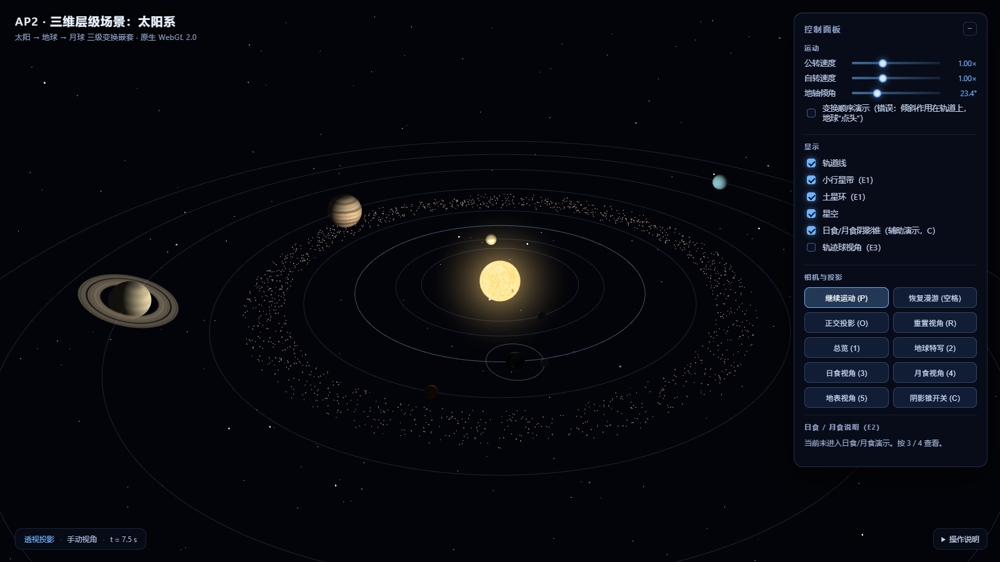

---

## 目录

1. [运行方式](#1-运行方式)
2. [功能一览](#2-功能一览)
3. [目录结构](#3-目录结构)
4. [必做内容实现要点](#4-必做内容实现要点)
   - 4.1 [层级变换树](#41-层级变换树必做-1)
   - 4.2 [手工构造的矩阵](#42-手工构造的矩阵必做-2)
   - 4.3 [表面纹理与 UV](#43-表面纹理与-uv必做-3)
   - 4.4 [双投影对比](#44-双投影对比必做-4)
   - 4.5 [相机漫游](#45-相机漫游必做-5)
   - 4.6 [参数面板](#46-参数面板必做-6)
5. [选做扩展](#5-选做扩展)
   - E1 [完整太阳系 + 土星环 + 小行星带](#e1-完整太阳系--土星环--小行星带)
   - E2 [日食 / 月食模拟](#e2-日食--月食模拟)
   - E3 [虚拟轨迹球](#e3-虚拟轨迹球)
6. [交互说明](#6-交互说明)
7. [自测与工具](#7-自测与工具)
8. [尺度与设计取舍](#8-尺度与设计取舍)
9. [评分点对照](#9-评分点对照)
10. [引用与来源](#10-引用与来源)

---

## 1. 运行方式

项目是纯静态站点，**没有构建步骤、没有 npm 依赖**。

### 在线运行（提交用 URL）

**<https://x1nghe159.github.io/AP2/>** —— 由 GitHub Pages 托管，点开即可运行。

源码仓库：<https://github.com/X1ngHe159/AP2>。

### 本地运行

```bash
# 任选一种静态服务器
python -m http.server 8123
# 或（自带零依赖服务器，推荐）
node tools/serve.mjs            # 默认 http://127.0.0.1:8123/
```

浏览器打开 <http://127.0.0.1:8123/>，等待纹理加载完成即可。

> **不要直接双击 `index.html`（file://）**：ES Module 与 `gl.texImage2D` 加载本地图片都受浏览器
> 同源策略限制，必须通过 http(s) 访问。

### 部署到其它静态托管

把**整个目录**（`index.html`、`css/`、`lib/`、`src/`、`assets/`）原样上传到任意静态托管即可，
无需任何配置：

- **GitHub Pages**：推到仓库 → Settings → Pages → 分支 `main` / 目录 `/`（本项目即如此部署）；
- 或 Netlify / Vercel / 学校主页空间 / 对象存储静态托管。

因为路径全部是相对路径，放在子目录（如 `https://xxx.github.io/AP2/`）也能直接运行。

### 浏览器要求

WebGL 2.0（Chrome / Edge / Firefox / Safari 15+）。若显卡不支持，浏览器会回退到软件光栅化。

---

## 2. 功能一览

| 类别 | 内容 |
|---|---|
| **层级结构** | 太阳 → 地球 → 月球 三级嵌套；地球公转 + 自转 + **23.44° 地轴倾角**（倾角先作用于地球自身，再挂到轨道节点） |
| **手动矩阵** | 月球轨道面倾角矩阵 `R_y(Ω)·R_x(i)` 由 `mat4` 元素手工填写 + `mult` 组合（见 4.2） |
| **纹理** | 太阳 / 地球 / 月球 / 8 颗行星 / 土星环 / 辉光共 12 张程序化位图；处理了 `UNPACK_FLIP_Y_WEBGL` 与 UV 的上下颠倒问题 |
| **双投影** | `O` 键在透视 / 正交之间切换，同一画面可直接对比近大远小与平行线 |
| **相机漫游** | 6 个关键帧环绕路径 + Catmull-Rom 插值，`空格` 暂停/继续；鼠标拖拽随时接管、空格恢复 |
| **参数面板** | 公转速度、自转速度、地轴倾角、轨道线/小行星带/土星环/星空开关、投影/漫游/预设按钮 |
| **E1 完整太阳系** | 8 颗行星（水金地火木土天海）、土星环、1500 颗小行星的小行星带 |
| **E2 日食/月食** | 可切换"侧上方 / 地球表面"视角，解析遮挡让被遮区域正确变暗，实时绘制**本影锥 + 半影圆台**（可开关），HUD 给出食类型；月食呈"血月"暗红 |
| **E3 虚拟轨迹球** | 教材第 2 章 Shoemake 弧球 + 四元数累计旋转，`T` 键开启 |

---

## 3. 目录结构

```
AP2/
├── index.html                 # 页面骨架、参数面板 HTML（内联控件）
├── css/style.css              # 深空风格 UI 样式
├── lib/                       # 教材 Common/ 工具库（经典脚本，直接 <script> 加载）
│   ├── MV.js                  # 列主序矩阵/向量库：mat4/translate/rotate/scale/mult/
│   │                          #   perspective/ortho/lookAt/normalMatrix/inverse…
│   ├── initShaders.js         # 编译/链接着色器，失败时打印 info log
│   └── webgl-utils.js         # 创建 WebGL2 上下文、按 DPR 调整画布尺寸
├── src/                       # 应用代码（ES Module，按职责分文件）
│   ├── main.js                # 入口：初始化、渲染循环、交互、截图自动化接口
│   ├── config.js              # ★ 天体参数集中配置（半径/距离/周期/倾角/纹理）
│   ├── scene.js               # ★ 层级变换树：逐层计算模型矩阵
│   ├── transforms.js          # ★ 手工矩阵构造（地轴倾角、月球轨道面倾角）
│   ├── camera.js              # 漫游关键帧、鼠标接管、双投影、预设视角
│   ├── renderer.js            # 绘制管线（body/flat/ring/glow 四个程序）
│   ├── shaders.js             # 全部 GLSL ES 3.00 着色器源码
│   ├── geometry.js            # 球面 / 单位圆 / 广告牌四边形 / 星空点云
│   ├── gl-utils.js            # VAO、纹理、网格上传封装
│   ├── texture-loader.js      # 位图纹理加载
│   ├── ui.js                  # 参数面板与 HUD 绑定
│   ├── trackball.js           # E3：虚拟轨迹球（纯数学）
│   ├── rings.js               # E1：土星环几何
│   ├── asteroid-belt.js       # E1：小行星带（确定性随机 + 逐帧动画）
│   └── eclipse.js             # E2：本影锥/半影圆台几何 + 食类型判定（纯数学）
├── assets/textures/           # 程序化生成的位图纹理 + manifest.json
├── tools/
│   ├── make_textures.py       # 纹理生成脚本（numpy + Pillow，固定种子可复现）
│   ├── test-mv.mjs            # 矩阵库单元测试（72 项）
│   ├── test-ext.mjs           # 扩展模块单元测试（106 项）
│   ├── test-geometry.mjs      # 球体几何回归测试（9 项：法线朝外/绕序/单位圆）
│   ├── smoke.mjs              # 无头浏览器交互冒烟测试（14 项）
│   ├── serve.mjs              # 零依赖静态服务器
│   ├── capture.mjs            # DevTools 协议无头截图 / 录屏帧采集
│   ├── shot.mjs               # 单张截图工具（可截本地或线上地址，便于验机位）
│   ├── make_gif.py            # 帧序列 → 10 秒漫游 GIF
│   └── make_zip.py            # 打包提交用的源码 zip
└── docs/
    ├── screenshots/           # README 所用截图
    ├── frames/                # 漫游录屏帧（体积较大，可重新生成，源码包中省略）
    └── roam-10s.gif           # 10 秒漫游录屏
```

---

## 4. 必做内容实现要点

### 4.1 层级变换树（必做 1）

代码位置：[`src/scene.js`](src/scene.js) + [`src/transforms.js`](src/transforms.js)。
矩阵语义遵循教材 Ch4：**列主序 4×4**，`mult(A, B) = A·B`，即**先对点应用 B，再应用 A**。

```
世界（World）
│
├── 太阳节点        M_sun      = R_y(太阳自转角) · S(R_sun)
│
├── 地球轨道节点    M_orbitE   = R_y(θ_E) · T(d_E, 0, 0)
│   │                          （先把地球平移到轨道半径处，再绕太阳旋转 θ_E）
│   │
│   ├── 地球刚体    M_earth    = M_orbitE · R_z(23.44°) · R_y(自转角) · S(r_E)
│   │                          └──────── 地球自身（倾角只作用于此）────────┘
│   │
│   └── 月球轨道节点 M_moonOrbit = M_orbitE · M_plane(i, Ω) · R_y(φ_M) · T(d_M, 0, 0)
│       │                        └─ 手造矩阵（见 4.2）─┘
│       │
│       └── 月球刚体 M_moon    = M_moonOrbit · R_y(月球自转角) · S(r_M)
│
├── 水星节点        M_planet   = R_y(θ_P) · T(d_P,0,0) · R_z(tilt_P) · R_y(spin_P) · S(r_P)
├── 金星节点 …（同上）
├── 火星 / 木星 / 天王星 / 海王星节点
└── 土星节点        M_saturn   = 同上；土星环 = M_saturn · RingGeometry
```

**"变换顺序决定结构"的三个具体体现：**

1. **地轴倾角写在轨道节点右侧**：`R_z(23.44°)` 作用的是地球这个刚体，
   倾斜的是地轴而不是地球绕太阳的位置矢量。如果把它左乘到轨道外
   （`R_z(tilt) · M_orbitE · …`），倾斜就会作用在整个轨道位置上，地球会像陀螺一样
   在轨道面上"点头"。参数面板里的**"变换顺序演示（错误顺序）"** 开关就是用来对比这两种写法的：

   | ✅ 正确顺序：倾角只作用于地球自身 | ❌ 错误顺序：倾角左乘到轨道外 |
   |---|---|
   | 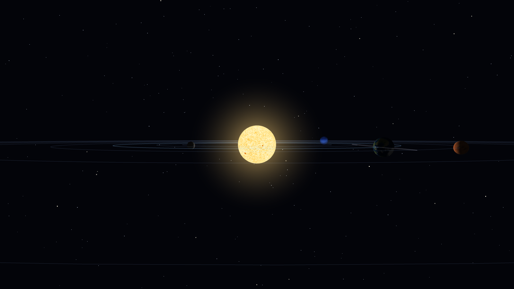 | 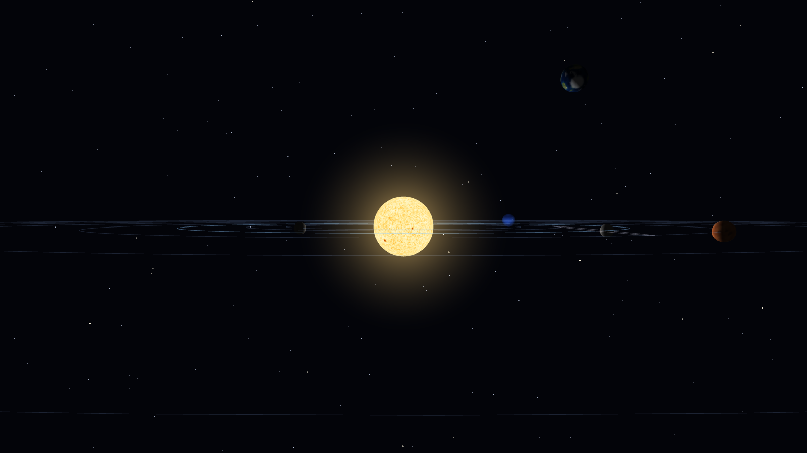 |

   两张图同为 `t = 2.5 s`、为了看得更清楚把倾角临时放大到 60°、从黄道面侧视：
   正确时地球乖乖待在黄道面的轨道线上；错误时地球被倾角"甩"到轨道面上方，
   而月球（挂在地球轨道节点下）仍然留在原轨道上 —— 这直观说明
   **矩阵乘法的顺序就是在定义场景结构**。

2. **月球挂在"地球轨道节点"下，而不是"地球刚体"下**：
   月球跟着地球绕太阳公转，但**不跟着地球自转**。如果挂在 `M_earth` 下，月球会 6 秒绕地球一圈
   （因为地球自转周期是 6 秒），显然错误。

3. **月球潮汐锁定**：月球挂在地球轨道节点下、随公转一起转，月球自身不再额外自转，
   所以同一面永远朝向地球（等价于自转周期 = 公转周期；若在月球自身矩阵里再加一次
   `R_y(公转角)`，就会变成每公转一圈自转两圈）。

> 参数全部集中在 [`src/config.js`](src/config.js)：改 `radius` / `orbitRadius` / `orbitPeriodSec` /
> `tiltDeg` / `texture` 即可调整任意天体，不必改场景代码。

---

### 4.2 手工构造的矩阵（必做 2）

**不使用** `MV.js` 里任何"复合封装"，而是：

- 用 `mat4()` 的 16 个元素**手工填写**旋转矩阵（cos/sin 放在哪一格按教材公式推导）；
- 用 `mult()` 把基本变换按"先作用的后乘"组合起来。

代码：[`src/transforms.js`](src/transforms.js)。

#### (a) 月球轨道面倾角矩阵（核心示例）

月球轨道面相对黄道面倾斜 `i = 5.145°`，升交点经度 `Ω`（配置里 `nodeDeg = 125°`）。
在世界（黄道）坐标系里，这个倾斜表达为两次绕坐标轴旋转的复合：

```
M_plane = R_y(Ω) · R_x(i)
```

- `R_x(i)`：把轨道平面绕 X 轴抬起 `i`（升交点在 +X 方向时）；
- `R_y(Ω)`：再绕 Y 轴把升交点转到 `Ω` 方向，决定倾斜朝向。

**逐元素推导**（行优先写法，c = cos i，s = sin i，cn = cos Ω，sn = sin Ω）：

```
        ⎡ 1   0   0 ⎤                  ⎡  cn  0  sn ⎤
R_x(i)= ⎢ 0   c  -s ⎥        R_y(Ω)=  ⎢  0   1   0 ⎥
        ⎣ 0   s   c ⎦                  ⎣ -sn  0  cn ⎦

                ⎡ cn   s·sn   c·sn ⎤
M_plane = R_y·R_x = ⎢ 0    c     -s   ⎥
                ⎣ -sn  s·cn   c·cn ⎦
```

对照代码里的列主序数组（每 4 个元素是一列）：

```js
// rotateXMatrix(i)：第 1 列 (0,c,s)、第 2 列 (0,-s,c)
[1,0,0,0,   0,c,s,0,   0,-s,c,0,   0,0,0,1]
// rotateYMatrix(Ω)：第 0 列 (cn,0,-sn)、第 2 列 (sn,0,cn)
[cn,0,-sn,0,  0,1,0,0,  sn,0,cn,0,  0,0,0,1]
// 组合
return MV.mult(node, tilt);   // = R_y(Ω) · R_x(i)
```

**验证矩阵语义**：`M_plane` 作用于升交点方向 `(1,0,0)` 得第一列 `(cn, 0, -sn)`，
其 `y` 分量为 0 —— 升交点确实落在黄道面上，符合轨道力学定义；作用于 `(0,0,1)` 得
`(c·sn, -s, c·cn)`，`y` 分量为 `-s ≠ 0`，说明轨道面被抬起了 `i` 角。

> 这个矩阵还顺便解决了日食对齐问题：共线时刻月球必定落在黄道面内（`y = 0`），
> 真正决定"能不能成食"的是**升交点方位** —— 默认 `nodeDeg = 125°` 时月球在共线时刻
> 偏离日地连线 125°，本影打不到地球；日食/月食演示时把 `nodeDeg` 设为 0，月球才挡在中间。

#### (b) 地轴倾角矩阵

```js
// 绕 Z 轴旋转 23.44°，把地球自转轴（局部 +Y）倾斜到世界方向
//   R_z(θ) = [ c -s 0 0; s c 0 0; 0 0 1 0; 0 0 0 1 ]（行优先）
// 列主序写出来就是：
[ c, s, 0, 0,   -s, c, 0, 0,   0, 0, 1, 0,   0, 0, 0, 1 ]
```

---

### 4.3 表面纹理与 UV（必做 3）

三个天体（太阳、地球、月球）以及全部 8 颗行星都贴了**真实 PNG 位图纹理**：

- 纹理图片在 [`assets/textures/`](assets/textures/)，由
  [`tools/make_textures.py`](tools/make_textures.py) 用 numpy + Pillow **程序化生成**
  （固定随机种子，可复现；不使用任何网络素材）；
- 上传：`gl.texImage2D(gl.TEXTURE_2D, 0, gl.RGBA, gl.RGBA, gl.UNSIGNED_BYTE, image)`，
  并 `gl.generateMipmap` + `LINEAR_MIPMAP_LINEAR`（WebGL2 支持非 2 的幂纹理）；
- 纹理坐标：球面顶点属性 `aTexCoord`，经度 → `u ∈ [0,1]`，纬度 → `v ∈ [0,1]`。

#### 地球纹理的"上下颠倒"问题

球面 UV 的约定是 **v = 0 在南极、v = 1 在北极**；而位图文件的第 0 行是**图像顶部**。
WebGL 默认把图像第 0 行上传为纹理第 0 行，`v = 0` 就采样到了图像顶部 ——
于是北极贴上了南极的图像，地球看起来**南北颠倒**。

两种修法：

| 方案 | 做法 | 本项目 |
|---|---|---|
| A. 上传时翻转 | `gl.pixelStorei(gl.UNPACK_FLIP_Y_WEBGL, true)`，让 `v=0` 对应图像底部 | ✅ 采用 |
| B. 改 UV | 把球面的 `v` 反过来（`v = lat/latBands`） | 不采用，容易与其它几何的 UV 约定冲突 |

对应代码（[`src/gl-utils.js`](src/gl-utils.js)）：

```js
gl.pixelStorei(gl.UNPACK_FLIP_Y_WEBGL, flipY);   // 关键：翻转图片行序
gl.texImage2D(gl.TEXTURE_2D, 0, gl.RGBA, gl.RGBA, gl.UNSIGNED_BYTE, image);
gl.pixelStorei(gl.UNPACK_FLIP_Y_WEBGL, false);   // 别忘了恢复，避免影响后续纹理
```

两个容易踩的细节：

1. **`WRAP_T` 必须用 `CLAMP_TO_EDGE`**：否则纬度接近极点时会采样到另一半球，出现"极点撕裂"；
   经度方向用 `REPEAT` 保证接缝连续。
2. **纹理必须经度无缝**：生成脚本把经度映射到三维圆上（`x = R·cos(lon)`、`z = R·sin(lon)`），
   直接在球面上采样三维噪声，经度方向天然闭合，球面接缝处不会出现竖直亮线。

数据流可以概括为：

```
位图文件 ──UNPACK_FLIP_Y──▶ 纹理对象（GPU）
                              │  sampler2D
球面顶点 aTexCoord (u,v) ──▶ 片元着色器 texture(uTexture, vTexCoord)
                              │
                           片元颜色 = 纹理颜色 × 光照系数
```

#### 土星环纹理（E1）

`saturn_ring.png` 是 1024×64 的 **RGBA 一维径向纹理**：横向 `u` 表示从内缘（0）到外缘（1），
竖向 `v` 固定取 0.5。alpha 通道里刻好了卡西尼缝和内/外缘的淡出，配合混合
`SRC_ALPHA, ONE_MINUS_SRC_ALPHA` 与关闭背面剔除，环带正反两面都可见。

---

### 4.4 双投影对比（必做 4）

按 `O` 键（或面板按钮）切换：

```js
// 透视：fovy = 45°，近大远小，平行线在远处汇聚
MV.perspective(45, aspect, 0.15, 900);

// 正交：取"与透视在 target 平面处同样视野"的半高，保证构图可比
const halfH = distance * Math.tan(45° / 2);
const halfW = halfH * aspect;
MV.ortho(-halfW, halfW, -halfH, halfH, 0.15, 900);
```

同一场景、同一时刻的对比：

| 透视投影（`O` 切到透视） | 正交投影（`O` 切到正交） |
|---|---|
|  | 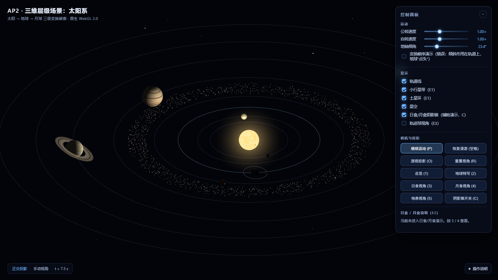 |

地球特写视角下的同一对比（两张图机位相同、target 平面取景一致，所以地球看起来一样大；
差别体现在月球：透视下月球离相机更近、显得明显更大，正交下不管远近大小都不变）：

| 透视 | 正交 |
|---|---|
| 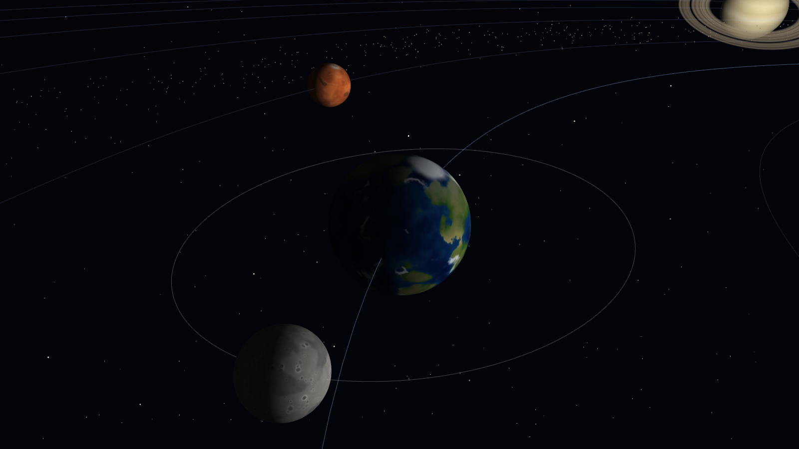 | 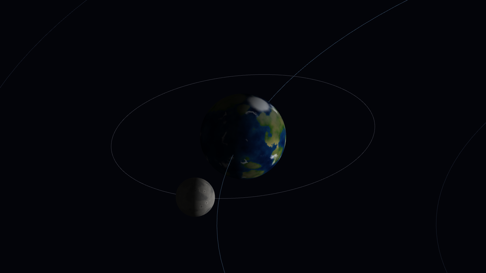 |

**差异说明：**

- **透视投影**：视锥是棱台，同样大小的物体离相机越远投影越小 —— 01 图里外侧轨道被压成更扁的
  椭圆、远端轨道线明显更密，最外侧轨道甚至被画面裁掉；地球特写里更靠近相机的月球（03）
  比正交图（04）里大一圈。平行线（相邻轨道在远处的部分）会向消失点汇聚。
- **正交投影**：投影方向全平行，没有透视除法（`w = 1`），**平行线永远保持平行**，
  同样尺寸的物体无论远近投影大小相同 —— 02 图里各轨道间距均匀、椭圆形状一致，
  画面像一张俯视的工程图，**没有近大远小**。
- 本项目特意用 `distance · tan(fov/2)` 计算正交半高，使两种投影在 **target 平面**处画面
  大小一致，差异只体现在深度方向上，对比更有说服力。

---

### 4.5 相机漫游（必做 5）

代码：[`src/camera.js`](src/camera.js)。

- **关键帧路径**：`config.camera.roamKeyframes` 定义了 6 组球坐标
  `{ azimuth, elevation, distance }`，绕场景一周、高度与距离起伏；
- **插值**：在关键帧之间用 **Catmull-Rom 样条**（首尾相接循环），保证速度和方向连续；
  方位角是周期量，插值时先 `unwrap` 到相邻区间，不会在 0/2π 处跳变；
- **暂停/继续**：`空格` 切换 `roamEnabled`，漫游与天体运动**互相独立**（`P` 才是暂停公转/自转）；
- **鼠标接管**：`pointerdown` 立即暂停漫游，并把当前 `eye` 反算成球坐标
  （`azimuth = atan2(rel.x, rel.z)`、`elevation = asin(rel.y / |rel|)`），
  所以拖拽从当前视角平滑继续，不会跳变；
- **滚轮接管**：滚轮缩放同样会先退出漫游再改距离（否则下一帧就被漫游路径覆盖，滚轮会"没反应"）；
- **恢复漫游**：再按 `空格` 时，在漫游路径上采样 240 个点，找到与当前 `eye` 最近的位置
  （`_seekRoamTime`），从那里继续播放，避免镜头"跳飞"。
- **跟随预设**：按 `2`/`3`/`4` 进入地球特写或日食/月食演示后，相机 target 会**每帧跟随地球**
  （`camera.follow = 'earth'`），所以地球继续公转也不会把画面甩出去。

10 秒漫游录屏（`docs/roam-10s.gif`，10 fps，800×450）：

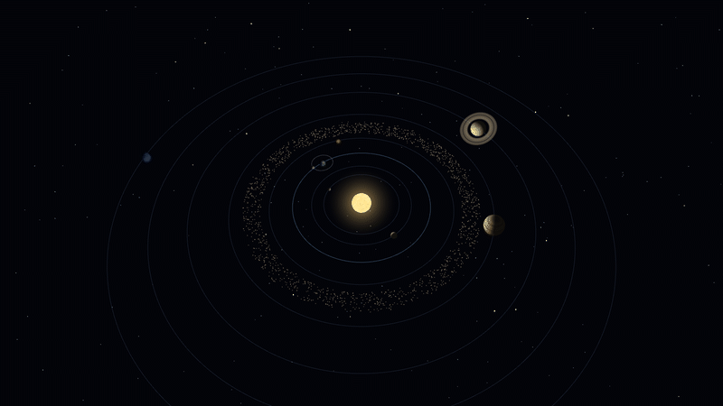

漫游中途的一帧（截图模式固定机位）：

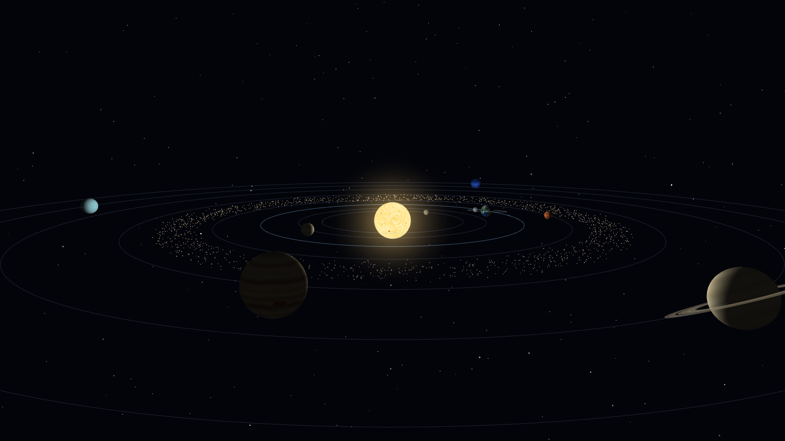

---

### 4.6 参数面板（必做 6）

| 控件 | 作用 | 实现 |
|---|---|---|
| 公转速度 0–3× | 缩放所有行星公转角速度 | `simTime += dt × orbitSpeed` |
| 自转速度 0–3× | 缩放自转角速度（与公转独立） | `spinTime += dt × spinSpeed` |
| 地轴倾角 0–90° | 实时修改地球轴倾角 | 直接传给 `earthAxialTiltMatrix(state.axialTiltDeg)` |
| 轨道线开关 | 显示/隐藏所有轨道线（含月球轨道） | `state.showOrbits` |
| 小行星带 / 土星环 / 星空 | 显示开关 | 同上 |
| 变换顺序演示 | 对比正确/错误的矩阵顺序 | `wrongOrder` 分支 |
| 相机与投影按钮 | 暂停/漫游/投影/重置/预设视角 | 见交互表 |

公转与自转用**两个独立的时间累加器**，所以拖动任一滑条都不会造成相位跳变。
月球是**潮汐锁定**的：它的自转由公转（轨道节点）带着走，因此"自转速度"滑条对它不起作用
（这本身就是真实的物理现象，不是 bug）。

---

## 5. 选做扩展

### E1 完整太阳系 + 土星环 + 小行星带

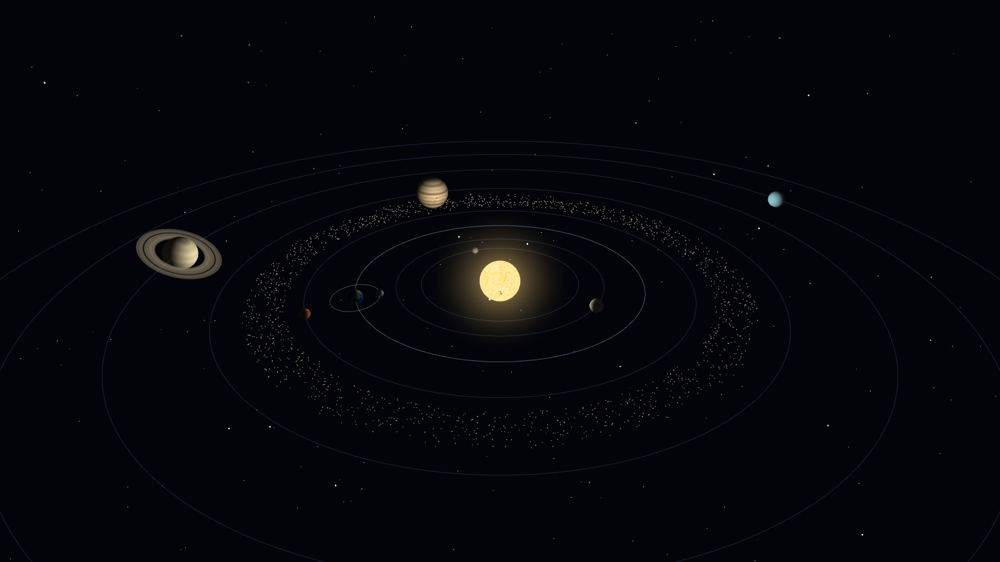

- **8 颗行星**（水星、金星、地球、火星、木星、土星、天王星、海王星），全部独立纹理、
  公转/自转/轴倾角参数，数据在 [`src/config.js`](src/config.js) 的 `planets` 数组；
- **土星环**：`src/rings.js` 程序化生成 XZ 平面的环带网格（内外两圈顶点 + 三角形索引），
  半径以土星半径为单位（1.35–2.40 R），贴径向 RGBA 纹理；环跟随土星的自转与轴倾角。
  环纹理里画好了多条明暗环带与卡西尼缝，外缘 alpha 渐隐到 0，不会出现硬边：

  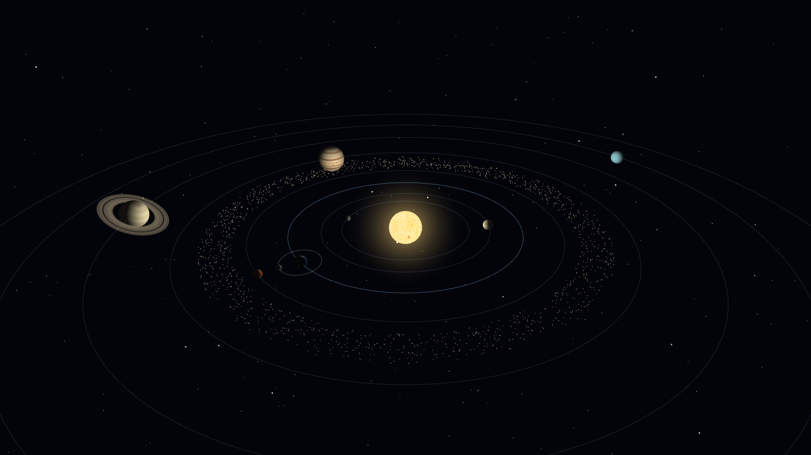
- **小行星带**：`src/asteroid-belt.js` 用 mulberry32 确定性随机生成 1500 颗小行星的轨道参数
  （半长轴 a、初相位、角速度 ∝ a^(-3/2)、升交点方位，以及固定的高度抖动 |y| ≤ thickness），
  每帧用 `updateAsteroidPositions()` 写回 `Float32Array` 并 `bufferSubData` 上传，
  以 `gl.POINTS` 圆点精灵渲染（逐点 alpha 由尺寸换算，远看有明暗层次）；
- 每颗小行星的位置完全由种子决定，刷新页面后分布一致，便于截图复现。

### E2 日食 / 月食模拟

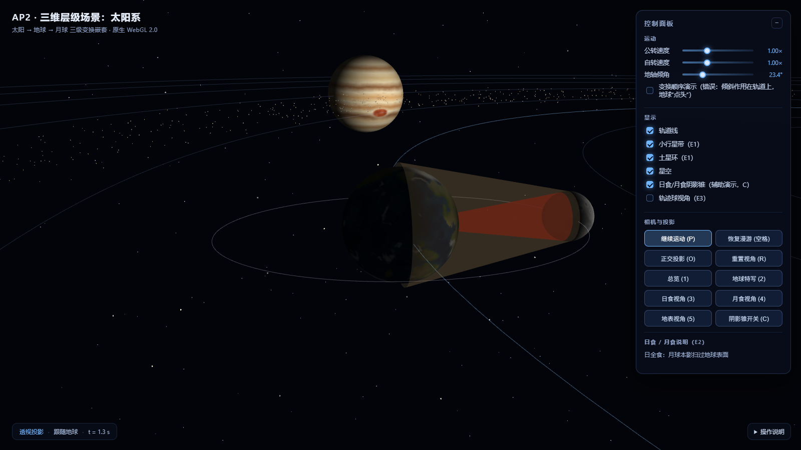

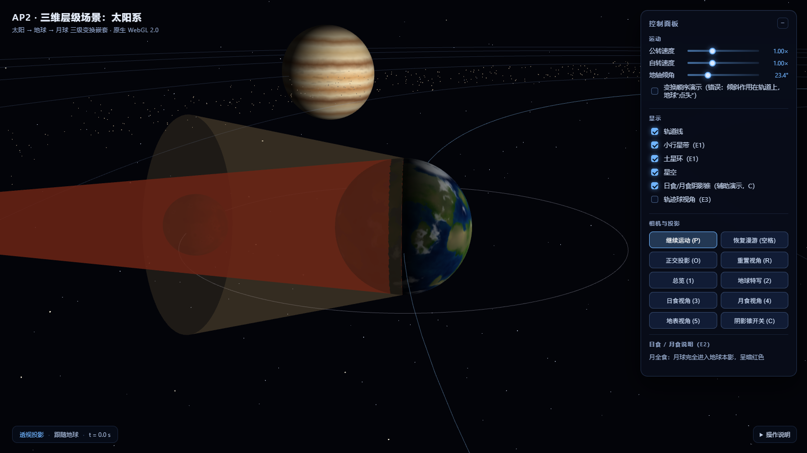

**视点切换**：按 `3` / `4`（或面板按钮）进入日食/月食演示，按 `5` 切到**地表视角**：

1. 把仿真时间对齐到"太阳-月球-地球"（或"太阳-地球-月球"）共线时刻
   （`scene.computeEclipseTime`：月球局部轨道角 180° → 日食，0° → 月食）；
2. 暂停天体运动（便于观察），并打开 `eclipseAlign`：把月球轨道面的**升交点转到日-地连线方向**。
   共线时刻月球本来就在黄道面内，真正让阴影打不中地球的是升交点方位 —— 默认 `nodeDeg = 125°`
   时月球偏离日地连线 125°，本影会从地球旁边掠过（真实世界中食之所以稀少，正是需要交点对准）；
3. 按视角需要选择机位（见下表）。

**三种观察方式**：

| 视角 | 按键 | 看到什么 |
|---|---|---|
| 侧上方 | `3` / `4` | 地球亮面 + 被本影/半影扫过的**暗区** + 半透明阴影锥 |
| **地球表面** | `5` | 抬头看天：日食时月球圆盘遮住太阳、天空变暗；月食时看到被地球本影染红的血月 |
| 自由观察 | 鼠标拖拽 / 滚轮 | 任意角度，可看月球/地球表面的明暗细节 |

| 地表视角 · 日食 | 地表视角 · 月食 |
|---|---|
| 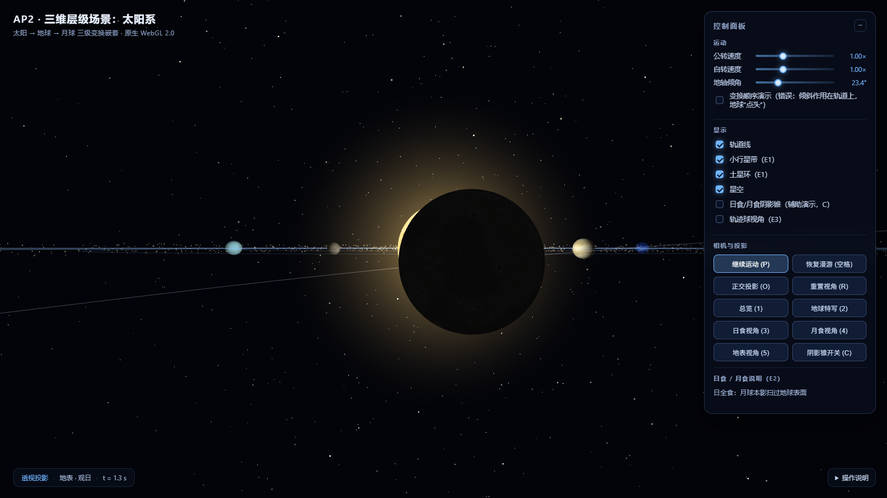 | 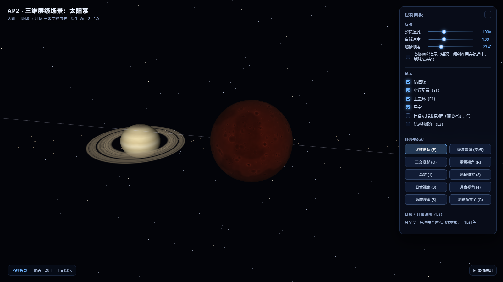 |

**辅助阴影锥开关**：面板复选框 / 按钮 / `C` 键可随时隐藏红色半透明的本影锥与半影圆台，
只保留天体本身的光影变化（对比"有无辅助演示"时很方便）。

**被遮挡区域为什么会变暗（解析遮挡）**：`BODY_FS` 里对受遮挡的天体逐片元计算
"从表面点看太阳时，遮挡体圆盘遮住了太阳圆盘的多少比例"：

```glsl
float delta = acos(dot(L, Lo));            // 太阳方向与遮挡体方向的角距
float alpha = asin(uSunRadius / dS);       // 太阳角半径
float beta  = asin(uOccRadius / dO);       // 遮挡体角半径
float occ   = clamp((alpha + beta - delta) / (2.0 * alpha), 0.0, 1.0);
// 本影 occ≈1 → 几乎全黑；半影平滑过渡
float sunVisible = 1.0 - 0.94 * occ;
```

这样被月影扫过的地球区域、进入地影的月球都会正确变暗，而不是"面向太阳就一律亮"。
月食时再叠一层暗红色调，得到"血月"——并且这层红光只作用在**朝向地球（≈朝向太阳）**的一面，
月球背面没有光照、保持暗黑（红光来自地球大气边缘，照不到背面）。不需要阴影贴图，代价也只是一个函数调用。

**光影说明（阴影几何）**：

- **本影锥（umbra）**：遮挡体背向太阳的收敛锥。太阳半径 `R`、遮挡体半径 `r`、日-遮挡体距离 `d` 时，
  锥顶距离遮挡体 `L = d·r / (R − r)`。本影内完全看不到太阳。
  日食时月球本影 `L ≈ 3.67`，地月距离 `3.50`，所以本影锥**够到地球表面** → 日全食；
- **半影圆台（penumbra）**：从遮挡体向背日方向**扩张**的圆台，距遮挡体 `t` 处半径
  `ρ(t) = r + (R + r)·t/d`。半影内只能看到太阳的一部分 → 日偏食；
- **月食**：地球半径大，地球本影长度 `L = d·R_E/(R_sun − R_E) ≈ 12.87`，远大于地月距离 3.50，
  所以月球能完全进入地球本影 → 月全食（现实中因大气折射呈暗红色，本项目用暗红色调模拟）。

锥体几何由 [`src/eclipse.js`](src/eclipse.js) 实时计算：在局部坐标生成"y=0 半径 r₀、y=1 半径 r₁"
的圆台网格，再用

```
M = T(遮挡体位置) · R(+Y → 背日方向) · S(1, L, 1)
```

把它摆到世界空间，用半透明混合渲染。HUD 会显示当前食类型（日全食/日环食/日偏食/月全食…）
以及日-地-月夹角。

### E3 虚拟轨迹球

按 `T`（或面板复选框）开启轨迹球视角。实现遵循教材第 2 章 Shoemake 的 Arcball 思想
（[`src/trackball.js`](src/trackball.js)）：

1. 把鼠标的归一化设备坐标 `(nx, ny) ∈ [-1,1]²` **投影到单位半球面**：
   `z = sqrt(r² − nx² − ny²)`；落在球外时用**双曲抛物面**
   `z = (r²/2) / sqrt(nx² + ny²)` 保证连续；
2. 前后两个球面点 `p0, p1` 的**叉积**给出旋转轴、**夹角**给出旋转角：
   `axis = normalize(p0 × p1)`，`angle = acos(p0·p1)`；
3. 用**四元数**累乘（`q ← q_Δ ⊗ q`，每步归一化），再转成 4×4 矩阵；
   四元数避免了欧拉角的万向节死锁，也保证累积矩阵始终正交（数值测试偏差 < 1e-5）；
4. 渲染时把累计旋转矩阵作用在相机相对 target 的偏移向量 `(eye − target)` 与 `up` 上，
   再用旋转后的 eye/up 重新 `lookAt`：视觉上就是**相机绕场景中心旋转**（太阳基本留在画面中心），
   而不是相机原地"歪头"。

复位（取消勾选或按 `R`）会清空累计旋转。

---

## 6. 交互说明

| 操作 | 功能 |
|---|---|
| **鼠标左键拖拽** | 旋转视角（自动接管漫游，从当前视角继续） |
| **滚轮** | 推近 / 拉远（接管漫游，距离限制 3.5–260） |
| **空格** | 暂停 / 继续**相机漫游** |
| **P** | 暂停 / 继续**天体运动**（公转、自转） |
| **O** | 透视 / 正交投影切换 |
| **R** | 重置视角（并退出日食演示） |
| **T** | 虚拟轨迹球模式开关（E3） |
| **L** | 显示 / 隐藏轨道线 |
| **1** | 总览视角 |
| **2** | 地球特写（跟随地球，可见地轴倾角、月球轨道） |
| **3** | 日食演示（自动对齐 + 阴影锥） |
| **4** | 月食演示 |
| **5** | 地表视角（站在地球表面看日食/月食） |
| **C** | 显示 / 隐藏辅助阴影锥 |
| **面板滑条** | 公转速度 / 自转速度 / 地轴倾角 |
| **面板复选框** | 轨道线 / 小行星带 / 土星环 / 星空 / 轨迹球 |

---

## 7. 自测与工具

```bash
# 矩阵库单元测试（列主序、组合顺序、透视/正交、lookAt、逆转置法线矩阵…）
node tools/test-mv.mjs          # 72 项全部通过

# 扩展模块单元测试（轨迹球、环几何、小行星带、日食阴影锥）
node tools/test-ext.mjs         # 106 项全部通过

# 球体几何回归测试（法线朝外、三角形绕序、单位圆、四边形）
node tools/test-geometry.mjs    # 9 项全部通过

# 浏览器端交互冒烟测试（无头 Edge 驱动：键盘/鼠标/投影/日食演示）
node tools/smoke.mjs            # 14 项全部通过

# 重新生成纹理（固定种子，可复现）
python tools/make_textures.py

# 重新生成 README 截图与漫游帧（无头浏览器）
node tools/capture.mjs
python tools/make_gif.py

# 打包提交用 zip
python tools/make_zip.py

# 单张截图（排查某个机位/参数下的画面，也可直接截线上地址）
node tools/shot.mjs "capture=1&preset=earth" out.png --url https://x1nghe159.github.io/AP2/
```

截图由 `tools/capture.mjs` 通过 **Chrome DevTools Protocol** 驱动无头 Edge：
页面在 `?capture=1` 模式下按 URL 参数把场景摆到确定状态（时间、投影、相机预设…）
并只渲染一帧，因此截图完全可复现。

---

## 8. 尺度与设计取舍

**必须说明**：本项目**没有**使用真实天文比例。原因是真实的太阳系无法在同一个画面里表现：

| 项目 | 真实值 | 本项目 |
|---|---|---|
| 太阳半径 / 地球半径 | 109 : 1 | 2.6 : 1 |
| 地球轨道 / 月球轨道 | 约 390 : 1 | 6 : 1 |
| 水星 / 海王星公转周期 | 88 天 / 165 年 | 8.6 s / 190 s |

如果按真实比例，太阳会是一个点、内行星全部挤在 1 像素内。因此对**半径、距离、周期**做了压缩，
但严格保持：**层级关系、变换顺序、公转/自转方向、轴倾角、月球绕地关系、环在赤道面内**。

其中月球轨道刻意取 3.5（约 3 倍地球半径），是"日食可见性"与"地面观感"的折中：
再近会让日食本影够不到地球，再远则从地表看月亮会小得像个点（真实月地距离是 60 倍地球半径）。
按当前参数，日食本影长度 3.67 > 月地距离 3.50（刚好日全食），地表看月亮约占画面 1/3。
所有压缩参数集中在 [`src/config.js`](src/config.js)，可以按需调整。

---

## 9. 评分点对照

| 评分维度 | 分值 | 本项目对应实现 |
|---|---|---|
| 层级与变换正确性 | 3 | 三级嵌套 `sun→earth→moon`（4.1）；倾角"先转后挂"并附错误顺序对照；月球轨道面倾角手造矩阵（4.2，`src/transforms.js`） |
| 观察与投影 | 2 | `O` 键双投影切换 + 同场景对比图与差异说明（4.4）；关键帧 Catmull-Rom 漫游、空格暂停、鼠标随时接管（4.5） |
| 交互与面板 | 2 | 公转/自转速度、轴倾角、轨道线/小行星带/土星环开关、投影/漫游/预设按钮全部生效（4.6、第 6 节） |
| 代码质量 | 1 | 参数集中配置（`config.js`）；几何 / 场景 / 相机 / 渲染 / 交互 / UI / 数学拆成 15 个模块；矩阵库 72 项、扩展模块 106 项、球体几何 9 项、浏览器交互 14 项测试全部通过 |
| README 与演示 | 1 | 本文档含变换嵌套树、矩阵逐元素推导、UV 数据流、双投影对比、10 秒漫游录屏、评分对照 |
| 选做扩展 | +2 | E1 完整太阳系 + 土星环 + 小行星带；E2 日食/月食模拟 + 阴影锥可视化；E3 虚拟轨迹球（第 5 节） |

---

## 10. 引用与来源

- **教材配套库**：`lib/MV.js`、`lib/initShaders.js`、`lib/webgl-utils.js` 按教材
  Angel & Shreiner《Interactive Computer Graphics》第 8 版 `Common/` 目录的 API 与用法
  **自行实现**（列主序矩阵、`initShaders` 编译流程、WebGL2 上下文创建），未直接复制第三方代码。
  其中矩阵函数均按教材 Ch4 的公式推导并附中文注释。
  与教材原文件的差异（为 WebGL2 适配）：`initShaders` 暴露 `createProgram(gl, vsSource, fsSource)`
  （教材里是 `initShaders(gl, vs, fs)`），`webgl-utils` 只负责创建 WebGL2 上下文与画布尺寸，
  矩阵 API（`mat4/translate/rotate/scale/mult/perspective/ortho/lookAt` 等）与教材保持一致。
- **算法参考**：
  - Virtual Trackball 思想来自教材第 2 章 / Shoemake, *ARCBALL: A User Interface for Specifying
    Three-Dimensional Rotation Using a Mouse* (1992)，本项目自行实现四元数累计版本；
  - 阴影锥的本影/半影公式由几何推导（相似三角形），见 5-E2；
  - Catmull-Rom 样条为标准插值公式。
- **纹理**：全部由 `tools/make_textures.py` 程序化生成（numpy + Pillow，固定随机种子），
  **未使用任何网络图片素材**。
- **无第三方 JavaScript 依赖**：没有使用 Three.js / glMatrix / lil-gui 等库。

---

## 附：生成产物说明

| 文件 | 说明 |
|---|---|
| `docs/roam-10s.gif` | 10 秒相机漫游录屏（10 fps，800×450） |
| `docs/frames/` | 录屏帧序列（`tools/capture.mjs` 重新生成） |
| `docs/screenshots/*.png` | README 引用的全部截图（1600×900） |
| `assets/textures/manifest.json` | 纹理清单与坐标约定 |
